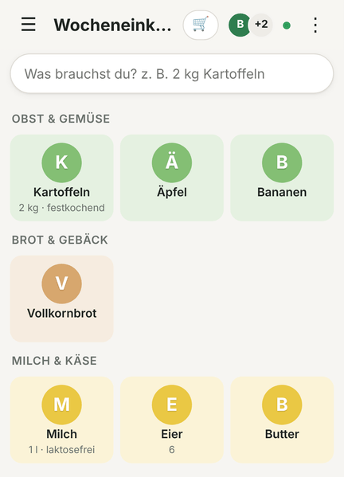
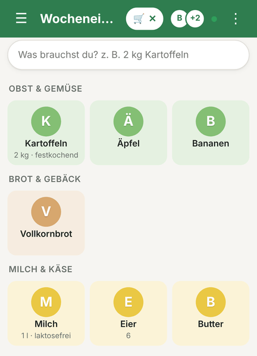
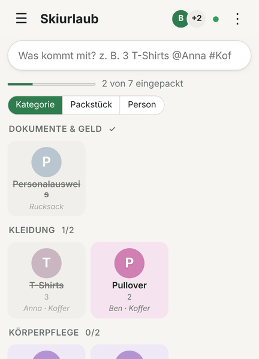
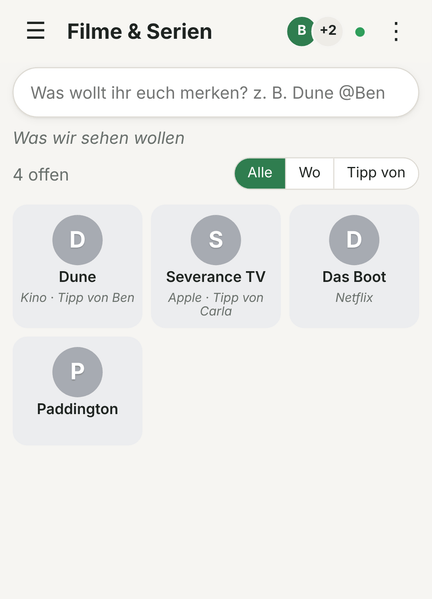
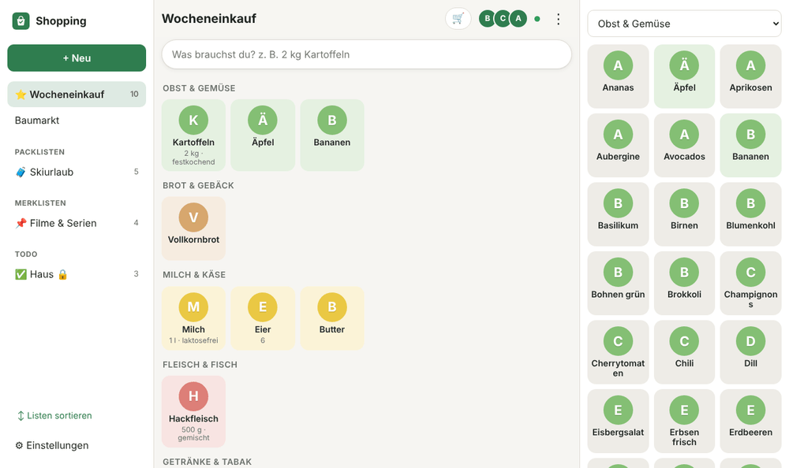

# Shopping 🛒

Shopping ist deine Listen-App für den ganzen Haushalt: der Wocheneinkauf, die
Packliste für den Skiurlaub, die Filme, die ihr endlich sehen wollt, und die
Aufgaben fürs Wochenende – alles an einem Ort, auf jedem Handy und am Laptop.
Was einer abhakt, sehen die anderen sofort. Und im Funkloch hinten im
Supermarkt läuft sie einfach weiter.

Kurz gesagt: kein Zettel am Kühlschrank mehr, keine fünf Apps für fünf Arten
von Listen – eine Eingabezeile, und „2 kg Kartoffeln festkochend“ steht da,
wo es hingehört.

| Zuhause | Im Laden | Packliste | Merkliste |
| --- | --- | --- | --- |
|  |  |  |  |

## Was Shopping für dich macht

- **Eine Zeile für alles** – „500 g Hack gemischt bio“, „Milch, Butter, 6 Eier“: Menge, Einheit
  und Eigenschaften werden erkannt, doppelte Artikel zusammengeführt (1 l + 2 l Milch = 3 l).
- **Sortiert, wie du durch den Laden gehst** – Artikel landen in Kategorien, deren Reihenfolge
  du dir selbst einstellst.
- **Zuhause nichts versehentlich abhaken** – zu Hause öffnet Antippen den Artikel, im
  Einkaufen-Modus hakt es ab, und der Bildschirm bleibt an.
- **In Echtzeit, auch offline** – Abhaken erscheint bei den anderen sofort, „✓ von Anna“. Ohne
  Netz wird gepuffert und später nachgeliefert.
- **Vier Arten von Listen** – Einkauf, Packliste (wer, welcher Koffer, „12 von 30 eingepackt“),
  Merkliste für Filme, Bücher und Restaurants (Tipp von, wo es das gibt) und ToDo-Listen mit
  Fälligkeit, nach Kategorien wie Arbeit oder Hobby geordnet.
- **Vorlagen** – „Wocheneinkauf Basis“ oder „Wochenend-Trip“ füllen neue Listen vor, und eine
  Liste lässt sich jederzeit mit ihrer Vorlage abgleichen – in beide Richtungen.
- **Für den ganzen Haushalt** – Listen gehören automatisch allen im Haushalt, auf Wunsch sind
  sie privat. Gäste kommen ohne Konto über einen Link dazu.
- **Mit Mealie** – was in Mealie auf der Einkaufsliste landet, kommt sauber sortiert an;
  Rezepte und Wochenplan holst du mit passenden Portionen herüber.
- **Mit Home Assistant und KI-Assistenten** – „Füge Milch zur Einkaufsliste hinzu“ über Assist,
  Listen in Claude & Co. über den eingebauten MCP-Server.
- **Eigene Icons** – auf Wunsch zeichnet eine Bild-KI jedem Artikel und jeder Liste ein Icon im
  selben Stil; der Film auf der Merkliste bekommt ein Motiv aus dem Film.
- **Als App installieren** – Shopping ist eine PWA; der Knopf „Installieren“ in der Titelzeile
  legt sie auf den Startbildschirm.

Alles im Detail: [docs/funktionen.md](docs/funktionen.md).

## Für wen ist das?

Shopping passt zu dir, wenn du ...

- mit mehreren Leuten einkaufst und keine Lust mehr hast, Listen per Messenger hin und her zu schicken,
- im Supermarkt regelmäßig kein Netz hast,
- Mealie für Rezepte nutzt und die Einkaufsliste dort zu umständlich findest,
- Home Assistant betreibst und die Einkaufsliste auch per Sprache füllen willst,
- selbst hostest und wissen willst, wo deine Daten liegen – hier: bei dir, in einer
  PostgreSQL-Datenbank.

## Schnellstart mit Docker

```bash
cp .env.example .env
cp docker-compose.example.yml docker-compose.yml
```

In `.env` mindestens `PUBLIC_URL`, `SECRET_KEY`, `POSTGRES_PASSWORD`, `OIDC_ISSUER` und
`OIDC_CLIENT_ID` ausfüllen (siehe „Login über OIDC“ unten), dann:

```bash
docker compose up -d
docker compose ps        # App und Datenbank zeigen "healthy"
```

Die App lauscht auf `127.0.0.1:38417`; davor gehört ein Reverse Proxy mit HTTPS (siehe
[Betriebsecke](#betriebsecke)). Das Image `ghcr.io/doenke/shopping:latest` wird bei jedem Push
gebaut, Datenbank-Migrationen laufen beim Start von selbst.

## Ein erster Rundgang

### 1. Liste anlegen

Anmelden, links auf **+ Neu**: Name, Typ (Einkauf, Packliste, Merkliste, ToDo), auf Wunsch aus
einer Vorlage. Die erste Einkaufsliste wird deine Hauptliste ⭐.

### 2. Eintippen

Oben in die Zeile: „2 kg Kartoffeln festkochend“ – Menge, Einheit und Eigenschaft werden
erkannt, der Artikel landet in seiner Kategorie. Mehrere auf einmal gehen mit Komma. Auf
Packlisten ordnen „@Anna“ und „#Koffer“ zu, auf ToDo-Listen setzt „!morgen“ die Fälligkeit.

### 3. Einkaufen

Im Laden auf 🛒 tippen: Der Kopf wird grün, Antippen hakt ab, der Bildschirm bleibt an. Wer
mitliest, sieht jeden Haken sofort. Ist alles gekauft, geht es von selbst zurück in den
Zuhause-Modus.



### 4. Teilen

Wer in deinem Haushalt ist, sieht deine Listen ohnehin. Für alle anderen schickt
**⋮ → Teilen …** einen Link; wer ihn öffnet, ist dabei – Gäste auch ohne Konto.

## Login über OIDC

Shopping meldet über OIDC an (Authorization Code + PKCE), zum Beispiel gegen
[Pocket ID](https://github.com/pocket-id/pocket-id). Leg dort einen Client an:

- Callback-URL: `${PUBLIC_URL}/auth/callback`
- öffentlicher Client mit PKCE – dann bleibt `OIDC_CLIENT_SECRET` leer
- wer rein darf, regelst du über „Allowed User Groups“

Das Profilbild aus Pocket ID erscheint in der App. Wer zu welchem Haushalt gehört, sagt ein
Custom Claim `household` – Details in [docs/haushalte-und-teilen.md](docs/haushalte-und-teilen.md).

## Kleine Konfiguration, große Wirkung

Für den normalen Betrieb brauchst du nur wenige Werte:

| Einstellung | Wofür? |
| --- | --- |
| `PUBLIC_URL` | Pflicht. Die Adresse, wie sie im Browser steht – daraus entstehen Callback, Links und die MCP-Adresse. |
| `SECRET_KEY` | Pflicht. Langer Zufallswert, verschlüsselt gespeicherte Zugangsdaten (Mealie, Bild-KI). Nach dem ersten Start nicht mehr ändern. |
| `POSTGRES_PASSWORD` | Pflicht. Passwort der mitgelieferten Datenbank. |
| `OIDC_ISSUER` / `OIDC_CLIENT_ID` | Pflicht. Dein Identity Provider. |
| `OIDC_ADMIN_GROUP` | Gruppe mit Admin-Rechten. Standard: `admins`. |
| `DEFAULT_HOUSEHOLD_NAME` | Name des Haushalts für alle ohne Haushalts-Tag. Standard: `Haushalt`. |

Alle Werte stehen kommentiert in [.env.example](.env.example) und in
[docs/betrieb.md](docs/betrieb.md).

## Home Assistant in Kürze

Die Integration installierst du über HACS → ⋮ → *Benutzerdefinierte Repositories*, Typ
**Integration**:

```
https://github.com/doenke/shopping
```

Danach *Integration hinzufügen → Shopping* mit Adresse und API-Token, und bei der Integration
**„Liste hinzufügen“** für jede Liste, die du in Home Assistant brauchst. Alles Weitere steht in
[docs/home-assistant.md](docs/home-assistant.md).

## Mehr dazu

| Thema | Wo |
| --- | --- |
| Alle Funktionen im Detail | [docs/funktionen.md](docs/funktionen.md) |
| Haushalte, Teilen, Gäste | [docs/haushalte-und-teilen.md](docs/haushalte-und-teilen.md) |
| Icons mit Bild-KI | [docs/icons.md](docs/icons.md) |
| Mealie | [docs/mealie.md](docs/mealie.md) |
| Home Assistant | [docs/home-assistant.md](docs/home-assistant.md) |
| REST-API, MCP, Webhooks | [docs/api-und-ki.md](docs/api-und-ki.md) |
| Betrieb, Updates, Versionen | [docs/betrieb.md](docs/betrieb.md) |
| Entwickeln, Aufbau, Konzept | [docs/entwicklung.md](docs/entwicklung.md) |

---

## Betriebsecke

Die kommentierte Compose-Vorlage liegt in
[docker-compose.example.yml](docker-compose.example.yml).

### Reverse Proxy (z. B. Nginx Proxy Manager)

Einen Proxy Host auf `127.0.0.1:38417` zeigen lassen, dann:

- **Websockets Support** einschalten – darüber laufen die Echtzeit-Updates (`/ws`).
- **Force SSL** einschalten – ohne HTTPS gibt es keinen Service Worker und damit keine
  Offline-App.

### Wichtige Hinweise für den Betrieb

- `SECRET_KEY` nach dem ersten Start nicht mehr ändern, sonst lassen sich gespeicherte
  Zugangsdaten (Mealie, Bild-KI) nicht mehr entschlüsseln.
- Backup: `pg_dump` der Datenbank – mehr gibt es nicht zu sichern.
- Updates: neues Image ziehen und neu starten. Die App im Browser holt sich die neue Version
  von selbst. Welche Version läuft, steht unten in den Einstellungen und in `/healthz`.
- `DEV_LOGIN=true` erlaubt die Anmeldung nur mit einem Namen – **niemals in Produktion**.
